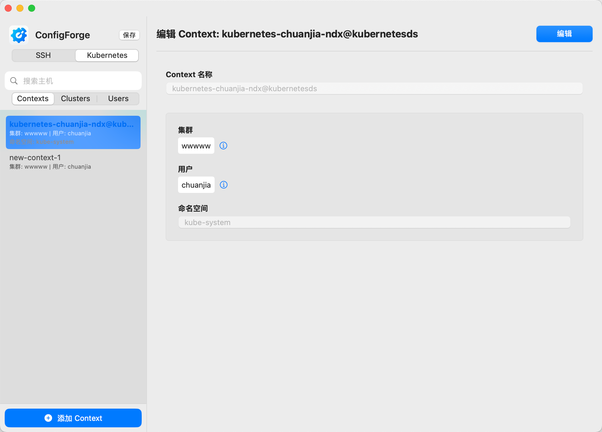
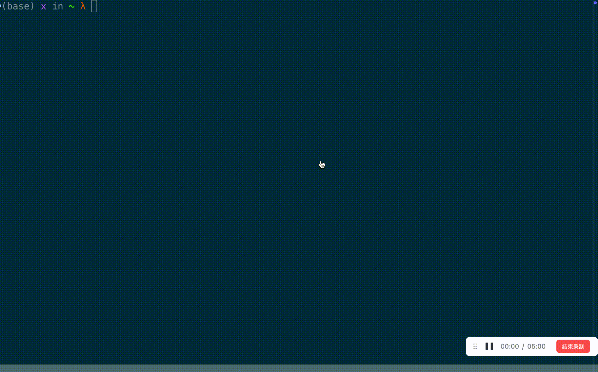

# ConfigForge

<p align="center">
  
</p>

<p align="center">
  <b>A simple and efficient SSH and Kuberenetes tool</b>
</p>

<p align="center">
  
  
  
  <a href="https://deepwiki.com/samzong/ConfigForge"></a>
</p>

## Introduction

ConfigForge is an open-source configuration management tool for macOS users,
supporting visual management of SSH and Kubernetes configurations.
It provides a simple UI to manage the '~/.ssh/config' and '~/.kube/config' files,

allowing you to easily to manage various configurations,
avoiding the cumbersome and error risks of directly editing text files.

### Screenshot

<p align="center">
  
</p>

As a completely open-source project, ConfigForge respects users' privacy and freedom.
All code is transparent and publicly available, ensuring that your configuration is safe and reliable.

### CLI Demo

<p align="center">
  
</p>

## Features

- 🖥️ Intuitive GUI for managing SSH hosts and KubeConfig files.
- ⚡️ Command-line tool cf for quick host connection and config switching.
- 🔒 Comprehensive SSH host management, supporting all standard directives and auto-detecting entries in .ssh/config.
- ☁️ Manage multiple KubeConfig files separately in .kube/configs without merging clusters.

## Installation

Recommend using Homebrew to install and update; `cf` command will be added to your PATH automatically.

```bash
brew tap samzong/tap
brew install configforge
```

If you still can't open the app, run this command in Terminal:

```bash
xattr -dr com.apple.quarantine /Applications/ConfigForge.app
```

## SSH Config Host Key

OpenSSH is a widely used secure remote login tool, and its configuration file `.ssh/config` allows users to define connection settings for different hosts.
The `Host` section is the core of the configuration file, used to specify configuration options for particular hosts.


| Configuration Item    | Description                           | Default     | Possible Values/Notes                              |
|-----------------------|---------------------------------------|-------------|--------------------------------------------------|
| `HostName`            | Specifies the actual hostname or IP address to log in to. | Command line name | Supports %h tokens, defaults to command line input hostname. |
| `User`                | Specifies the username for remote host login. | -           | String, overrides default user.                  |
| `Port`                | Specifies the SSH server port number. | 22          | Integer, defaults to 22.                         |
| `IdentityFile`        | Specifies the path to private key file for authentication. | ~/.ssh/id_rsa etc | Supports ~ and tokens, multiple files allowed, defaults to standard paths. |
| `AddKeysToAgent`      | Controls whether to automatically add keys to ssh-agent. | no          | yes, ask, confirm, no, or time interval (e.g. 1h). |
| `AddressFamily`       | Specifies the address family to use for connections (e.g. IPv4 or IPv6). | any         | any, inet, inet6.                               |
| `BatchMode`           | Used for scripts, disables password prompts. | no          | yes, no.                                        |
| `BindAddress`         | Specifies the local binding address. | -           | IP address, only useful on multi-address systems. |
| `CanonicalizeHostname`| Controls whether to canonicalize hostnames. | no          | no, yes, always, none.                          |
| `CheckHostIP`         | Controls whether to check if host IP is in known_hosts file. | no          | yes, no.                                        |
| `Ciphers`             | Specifies allowed encryption algorithms and priorities. | See description | Comma-separated list, supports +, -, ^ prefixes, query available options with ssh -Q cipher. |
| `Compression`         | Enables or disables data compression. | no          | yes, no.                                        |
| `ControlMaster`       | Enables sharing multiple sessions over a single network connection. | no          | yes, ask, auto, autoask, no.                    |
| `ControlPath`         | Specifies the path for control socket, used for connection sharing. | -           | Path, supports ~ and tokens, or "none" to disable. |
| `DynamicForward`      | Sets up local dynamic application-level port forwarding as SOCKS proxy. | -           | [bind_address:]port, supports IPv6 with brackets. |
| `EscapeChar`          | Sets the escape character for the connection. | ~           | Single character, "^" followed by letter, or "none" to disable. |
| `ForwardAgent`        | Allows forwarding of authentication agent connection. | no          | yes, no, path, or environment variable starting with $. |
| `ForwardX11`          | Enables X11 forwarding.               | no          | yes, no.                                        |
| `GlobalKnownHostsFile`| Specifies the global known hosts key file. | /etc/ssh/ssh_known_hosts, /etc/ssh/ssh_known_hosts2 | Space-separated paths, supports ~ and tokens. |
| `HostKeyAlgorithms`   | Specifies host key signature algorithms. | See description | Comma-separated list, supports +, -, ^ prefixes, query available options with ssh -Q HostKeyAlgorithms. |
| `IdentitiesOnly`      | Only use identity files specified in config file, ignore ssh-agent. | no          | yes, no.                                        |
| `IdentityAgent`       | Specifies the UNIX domain socket for communicating with authentication agent. | -           | Path, "none", "SSH_AUTH_SOCK", or environment variable starting with $. |
| `LocalForward`        | Sets up local port forwarding.        | -           | [bind_address:]port host:hostport, supports IPv6 with brackets. |
| `LogLevel`            | Sets the verbosity level for logging. | INFO        | QUIET, FATAL, ERROR, INFO, VERBOSE, DEBUG, DEBUG1, DEBUG2, DEBUG3. |
| `MACs`                | Specifies message authentication code algorithms. | See description | Comma-separated list, supports +, -, ^ prefixes, query available options with ssh -Q mac. |
| `PasswordAuthentication` | Controls whether to use password authentication. | yes         | yes, no.                                        |
| `PreferredAuthentications` | Specifies the order of authentication methods. | gssapi-with-mic,hostbased,publickey,keyboard-interactive,password | Comma-separated list. |
| `ProxyCommand`        | Specifies the command to connect to the server. | -           | Command string, supports %%, %h, %n, %p, %r tokens, "none" to disable. |
| `ProxyJump`           | Specifies jump host for proxy.        | -           | [user@]host[:port] or SSH URI, multiple comma-separated, "none" to disable. |
| `PubkeyAuthentication`| Controls whether to try public key authentication. | yes         | yes, no, unbound, host-bound.                   |
| `RemoteForward`       | Sets up remote port forwarding.       | -           | [bind_address:]port host:hostport, supports IPv6 with brackets. |
| `SendEnv`             | Specifies environment variables to send to server. | -           | Variable names, supports wildcards, multiple space-separated or multi-line. |
| `ServerAliveInterval` | Sets the interval for server keep-alive messages. | 0 (disabled) | Seconds, 0 means disabled.                      |
| `StrictHostKeyChecking`| Controls how to check host keys.      | ask         | yes, no, ask.                                   |
| `UserKnownHostsFile`  | Specifies the user's known hosts file. | ~/.ssh/known_hosts, ~/.ssh/known_hosts2 | Space-separated paths, supports ~ and tokens. |
| `VerifyHostKeyDNS`    | Controls whether to verify host keys via DNS. | no          | yes, no.                                        |

There are more than 100 configuration items in the `Host` section of the `.ssh/config` file.
Please refer to the official documentation: [OpenSSH Manual Pages](https://www.openssh.com/manual.html) and [Linux man page for ssh_config(5)](https://man7.org/linux/man-pages/man5/ssh_config.5.html).

## Builds and releases

`ConfigForge/Info.plist` is the source for the app version and build number.
Run `ruby scripts/verify-release.rb` on macOS to exercise the release workflow without publishing a release.
Run `make dmg VERSION=0.2.1` to package both architectures with Xcode and SwiftGen installed.
The output names are `ConfigForge-0.2.1-arm64.dmg` and `ConfigForge-0.2.1-x86_64.dmg` in `build/`.

Pull requests and pushes to `main` build DMGs in Actions.
Download the `ConfigForge-commit.<full-sha>` artifact from the Development Build run.
Actions retains these development artifacts for 90 days.
These artifacts are CI snapshots, not published release versions.

Published versions use immutable `vX.Y.Z` tags or `vX.Y.Z-alpha.N`, `vX.Y.Z-beta.N`, and `vX.Y.Z-rc.N` prerelease tags.
Prerelease counters start at 1.
Before an authorized release, commit the matching core version and an increased build number in `ConfigForge/Info.plist`.
The release workflow rejects invalid tags and version mismatches before Xcode runs.
It publishes only the release for that tag and rejects changes to an already published release.
Prereleases stay outside the stable latest channel.
Historical `develop` and `latest` tags remain unchanged. New builds do not update those channel pointers.
Homebrew updates use the centralized tap scanner instead of a repository dispatch.

## License

This project is licensed under the MIT License - see the [LICENSE](LICENSE) file for details.

## Acknowledgments

- Thanks to all open source project contributors
- [Swift](https://swift.org/) and [SwiftUI](https://developer.apple.com/xcode/swiftui/) teams
- [Swift Argument Parser](https://github.com/apple/swift-argument-parser) for CLI development
- All users who provided feedback and suggestions
